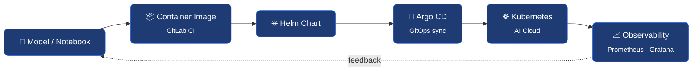

<!-- ============================================================
     Header
     ============================================================ -->

  

  

  
  
  
  

 

## 👋 Hi, I'm Paul

I've been into tech for 9+ years. I started as an IT administrator, moved into IT and cloud security, and now build platforms
that take AI applications **from the first notebook to a production-ready deployment**.
I don't just like keeping things running, I like making them better.

 

## ☸️ What I'm working on right now

At **[BITMARCK](https://www.bitmarck.de)** I'm a **DevOps Engineer in the AI Cloud team**. We're building a
**self-service Kubernetes platform** where AI/ML applications run efficiently and securely at scale, so data science teams
can focus on their models instead of on infrastructure.

- ⎈ &nbsp;**Kubernetes & Helm:** platform building blocks and reusable Helm charts for AI workloads
- 🐙 &nbsp;**GitOps with Argo CD:** everything declarative, versioned and reproducible
- 🔁 &nbsp;**CI/CD with GitLab:** from commit to container image to cluster
- 🔐 &nbsp;**Security by design:** close collaboration with security and infrastructure teams
- 🤝 &nbsp;**Enablement:** taking operational complexity off data scientists' plates

 

## 🎯 Side project: ScoreMate

<table>
  <tr>
    <td width="62%" valign="top">

**ScoreMate** is a darts scoring app I build in my free time, out of personal interest and because I play darts myself.
It's a simple, clean way to keep score and track your games and stats, built with **Flutter & Dart**.

It's my playground for everything that has nothing to do with clusters: UI/UX, mobile development and shipping a
real product end to end.

  </td>
    <td width="38%" align="center" valign="middle">
      <!-- TODO: add a screenshot, e.g. ./assets/scoremate.png -->
      
       <b>Flutter · Dart · Android</b>
    </td>
  </tr>
</table>

> [!TIP]
> Play darts? Give **[ScoreMate](https://www.scoremate.de)** a try, and feel free to open an issue or send me feedback 🎯

 

## 🧰 Tech stack

**Platform & DevOps**

  
   
  
  
  

**Cloud & Security**

  
   
  
  
  

**Languages & Frameworks**

  

 

## 🛤️ My journey

Admin → Security → Cloud Security → Platform Engineering for AI

| When | Role | Where |
| :--- | :--- | :--- |
| **2026 – now** | ☸️ **DevOps Engineer – AI Cloud** | BITMARCK · Essen |
| 2024 – 2026 | 🔐 Security Engineer – Cloud Services *(working student)* | GBTEC Group · Bochum |
| 2023 – 2024 | 🏭 IT Security Manager, OT security *(working student)* | MEISTERWERKE · Rüthen |
| 2021 – 2022 | 📱 Software Developer, research project *(working student)* | Hochschule Hamm-Lippstadt |
| 2017 – 2020 | 🖧 IT Administrator *(apprenticeship)* | Hämmerling Group Logistic · Paderborn |

<b>🎓 Education & certifications</b> (click to expand)

 

| | |
| :--- | :--- |
| 🎓 **M.Sc. Computer Science**, Hochschule Bochum · 2024 – 2026 | Grade **1.5** · Thesis: *Modernization & performance enhancement of the PARAY ray tracer through OpenMP parallelization* (**1.0**) |
| 🏆 **B.Eng. Intelligent Systems Design**, Hochschule Hamm-Lippstadt · 2020 – 2023 | Grade **1.3** · **Valedictorian** (WAGO Foundation award) · Thesis: *Machine learning for defence against phishing attacks* (**1.0**) |
| 🌉 **Semester abroad**, San Francisco State University · 2022 | Free mover · ML, data science & data analysis · GPA **4.0** |
| 🖧 **Fachinformatiker Systemintegration** · 2017 – 2020 | Grade **1.6** |
| 📜 **Certifications** | Cisco CCNA Routing & Switching · Cambridge English C1 Advanced (196) |

 

## 🚀 More things I've built

<table>
  <tr>
    <td width="50%" valign="top">
      <h4>⚡ PARAY Ray Tracer Modernization</h4>
      Master's thesis 
      Parallelized a legacy ray tracer with OpenMP and modernized its build system for a significant speedup on modern CPUs.  
      
    </td>
    <td width="50%" valign="top">
      <h4>🎣 ML for Phishing Defense</h4>
      Bachelor's thesis 
      Evaluated and compared ML models for detecting phishing emails, with NLP-based feature engineering.  
      
    </td>
  </tr>
  <tr>
    <td width="50%" valign="top">
      <h4>🎮 Calculated Chaos</h4>
      Hobby game · in progress 
      A fast-paced 2D roguelike action game with unique abilities and dynamic level design.  
      
    </td>
    <td width="50%" valign="top">
      <h4>🫁 Respiratory Sound Classification</h4>
      University project 
      Classifying respiratory diseases such as asthma and COPD from breath sounds and patient data.  
      
    </td>
  </tr>
</table>

 

## 📊 GitHub activity

<!-- Replace USERNAME with your GitHub username. The snake requires .github/workflows/snake.yml in this repo. -->

  <picture>
    <source media="(prefers-color-scheme: dark)" srcset="https://raw.githubusercontent.com/USERNAME/USERNAME/output/github-snake-dark.svg" />
    
  </picture>

 

<!-- ============================================================
     Footer
     ============================================================ -->

  <b>Let's talk about platforms, AI or darts.</b> 
  <a href="https://paulhartung.de">paulhartung.de</a> · <a href="https://www.linkedin.com/in/paul--hartung">LinkedIn</a>

  

